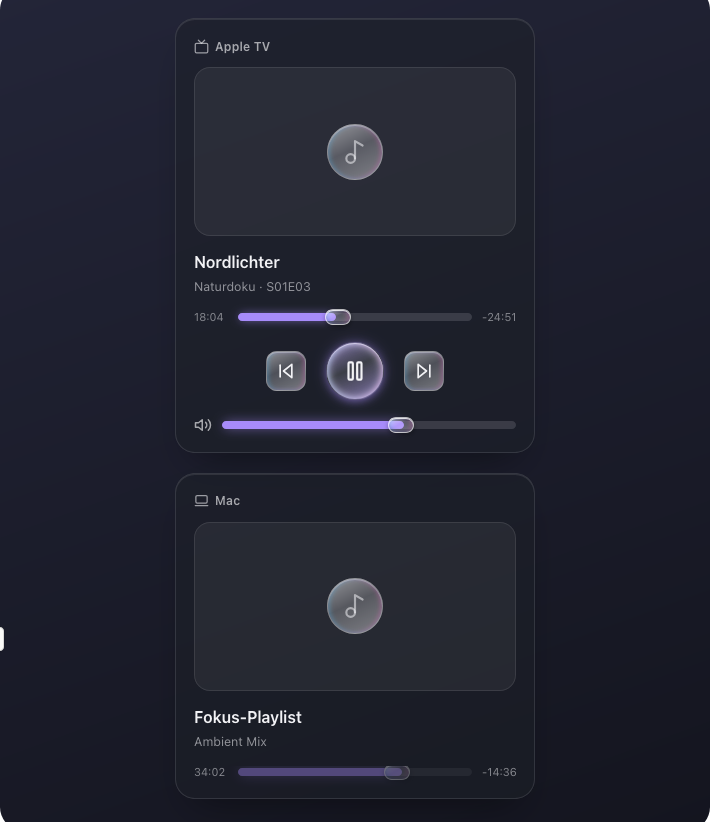

# Media Player Glass Card

A frosted-glass Home Assistant media-player tile in the Liquid Glass style — real
artwork, a draggable progress/volume "lens" slider, and transport controls that
only appear when the entity actually supports them.

Designed to sit alongside [`liquid-glass-tile-card-v2`](https://github.com/donsebby/liquid-glass-tile-card-v2)
and [`liquid-lens-navbar-card`](https://github.com/donsebby/liquid-lens-navbar-card) —
shares the same glass-panel tokens, icon-box gradient, and chromatic-edge lens styling.

One card instance shows **one** media_player entity. Combine with
[`auto-entities`](https://github.com/thomasloven/lovelace-auto-entities) to show a
card per active player (e.g. only while `playing`/`paused`) — see example below.



## Options

| Name | Type | Default | Description |
|---|---|---|---|
| `entity` | string | **required** | A `media_player.*` entity ID |
| `label` | string | entity ID | Small label shown top-left |
| `icon` | string | `mdi:cast` | Small icon shown next to the label |
| `accent_color` | string | `#a78bfa` | Accent used for the play button, progress fill, and volume fill |
| `bg_opacity` | number (0–1) | `0.7` | Panel background opacity (matches `liquid-glass-tile-card-v2`'s `bg_opacity`) |
| `look` | string | — (theme, else glass) | `solid` switches to a calm, solid panel without glass, see *Solid look*. `glass` forces glass. Without it the theme's `lg-look` decides, otherwise the card keeps the glass look |

Controls are feature-gated against the entity's `supported_features`: transport
buttons (prev/play-pause/next) and the volume slider are only rendered at all when
the entity reports that capability, and the progress bar becomes non-interactive
(but stays visible) when the entity doesn't support `SEEK`.

## Solid look

`look: solid` swaps the glass for a calm, solid panel, matching `look: solid` in
`liquid-glass-tile-card-v2`:

- **Panel:** solid surface from the optional CSS variable `--surface` (default: the
  theme's card background at 88 %), a hairline border, no blur and no shadow.
  `bg_opacity` has no effect in this look.
- **Buttons:** flat round buttons (44 px, play/pause 58 px) without gradients,
  inner edges or glows. Play/pause is filled with `accent_color` while playing.
- **Sliders:** progress and volume are plain bars with an accent fill – no glass
  lens, no glow – with a taller invisible touch area. Dragging works as before.
- **Artwork** stays; its frame uses `--lg-tile-bg` and the inner radius.
- Text: title 15 px, artist/series and label 13 px in the secondary text colour.
- Transitions are switched off for `prefers-reduced-motion`.

```yaml
type: custom:media-player-glass-card
entity: media_player.living_room
label: Living room
look: solid
```

The look can also come from your theme, for all Liquid Glass cards at once: set
`lg-look: solid` in the Home Assistant theme (the CSS variable `--lg-look`, value
`solid` or `glass`). `look:` on a single card overrides the theme; without either the
card stays glass. The card picks up theme switches on its own.

```yaml
# in your Home Assistant theme
lg-look: solid
```

## Example: one card per currently active player

```yaml
type: custom:auto-entities
card:
  type: vertical-stack
show_empty: false
filter:
  include:
    - entity_id: media_player.living_room_appletv
      state: playing
      options:
        type: custom:media-player-glass-card
        label: Apple TV
        icon: mdi:apple
    - entity_id: media_player.living_room_appletv
      state: paused
      options:
        type: custom:media-player-glass-card
        label: Apple TV
        icon: mdi:apple
sort:
  method: state
```

## Installation

### HACS (recommended)

Add this repository as a custom repository in HACS (category: Dashboard), then
install "Media Player Glass Card".

### Manual

Copy `media-player-glass-card.js` into `<config>/www/`, then add it as a
Lovelace resource:

```yaml
resources:
  - url: /local/media-player-glass-card.js
    type: module
```

## Theme variables

Like the other Liquid Glass cards, this card reads two optional CSS variables, so one theme can align all of them:

```yaml
# in your Home Assistant theme
lg-radius: 22px                          # corner radius of the glass panel
lg-backdrop: blur(22px) saturate(180%)   # blur/saturation behind the panel
```

Without them nothing changes. Options set on the card itself (e.g. `blur`) still win.

## Changelog

### Unreleased
- Solid look: round buttons take edge and shadow from the theme too.
- Solid look: the panel takes its fill from `--lg-tile-bg` when the theme sets it (glass solid look).
- Solid look: the card's own panel takes edge, shadow and blur from the theme (`--lg-tile-edge`, `--lg-tile-shadow`, `--lg-panel-backdrop`).
- Solid look: inner surfaces take their edge and shadow from the theme (`--lg-tile-edge`, `--lg-tile-shadow`), so a glass theme can give them a light glass edge.

### 1.1.0
- The look can come from the theme: `lg-look: solid` (CSS variable `--lg-look`) switches all Liquid Glass cards to the solid look; `look:` on the card overrides it (see *Solid look*).
- New card option `look: solid`: a calm, solid panel instead of glass (see *Solid look*). Solid surface from the optional `--surface`, flat round buttons, play/pause filled with the accent while playing, plain progress/volume sliders without the glass lens or glow, larger text (15/13 px). Without `look` the card renders exactly as before.
- The console banner shows the actual card version.

### 1.0.1
- Reads the optional theme variables `--lg-radius` and `--lg-backdrop` (see *Theme variables*).

## License

MIT
